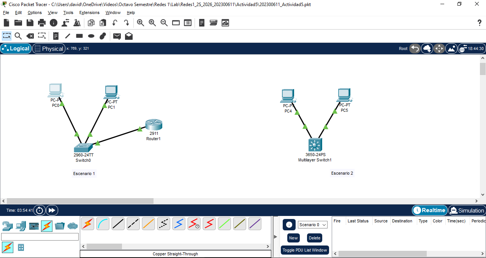
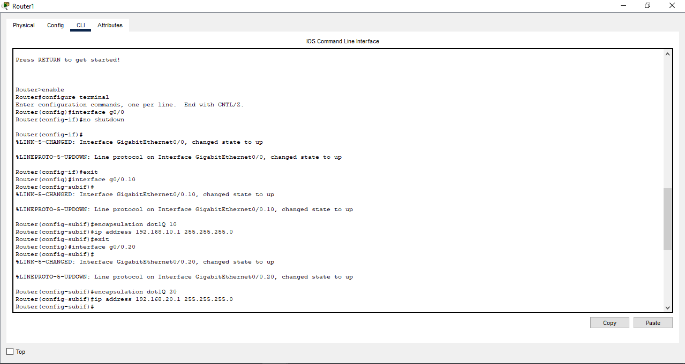
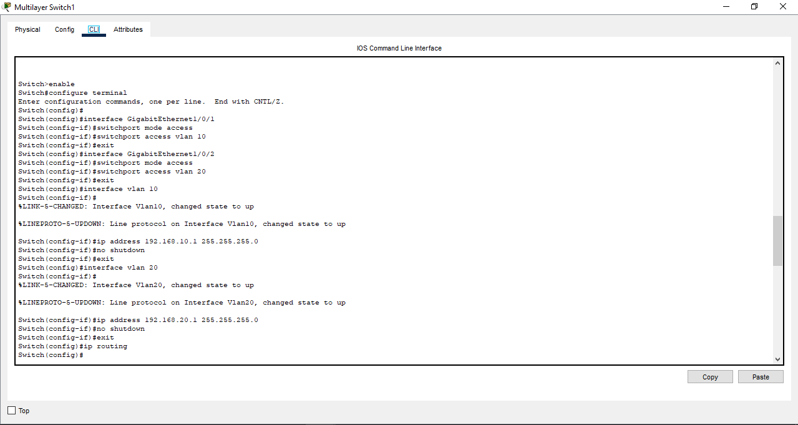
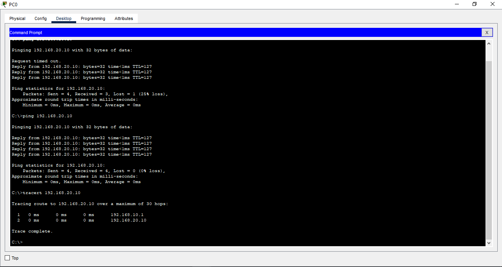

# Universidad San Carlos de Guatemala
## Facultad de Ingeniería - Escuela de Ingeniería en Ciencias y Sistemas
### Redes de Computadoras 1 - Laboratorio
**Actividad Práctica 5: Enrutamiento Inter-VLAN**

---

## 1. Topología Completa
A continuación se presenta la topología diseñada en Cisco Packet Tracer, la cual incluye los dos escenarios de configuración evaluados: Router-on-a-Stick y Switch de Capa 3.

---

## 2. Escenario 1: Router-on-a-Stick (ROAS)

### 2.1. Configuración de Subinterfaces
Evidencia de la configuración de las subinterfaces lógicas en la interfaz física del Router 2911, aplicando el encapsulamiento 802.1Q (dot1Q) para las VLANs 10 y 20.

### 2.2. Tabla de Enrutamiento (Router)
Salida del comando `show ip route` en el Router, confirmando que conoce las rutas conectadas directamente a través de sus subinterfaces.

---

## 3. Escenario 2: Switch de Capa 3 (SVI)

### 3.1. Configuración de SVIs y Enrutamiento
Creación de las Interfaces Virtuales de Switch (SVI) para las VLANs 10 y 20, asignación de direcciones IP y la activación del enrutamiento mediante el comando `ip routing` en el Switch Multicapa 3650.

### 3.2. Tabla de Enrutamiento (Switch L3)
Salida del comando `show ip route` en el Switch Multicapa, demostrando sus capacidades de enrutamiento de capa 3 activas.

---

## 4. Pruebas de Conectividad
Verificación de conectividad Inter-VLAN. Se evidencia un envío de paquetes exitoso (`ping`) y la traza de la ruta (`tracert`) desde una terminal en la VLAN 10 (Marketing) hacia una terminal en la VLAN 20 (Engineering), confirmando que el tráfico pasa correctamente por el gateway predeterminado.

---

## 5. Análisis Técnico

**Pregunta:** ¿Cuál de los dos métodos considera más eficiente para una red empresarial de alto tráfico y por qué?

**Respuesta:** 
Para una red empresarial de alto tráfico, el método más eficiente es el uso de un **Switch de Capa 3 (SVI)**. La principal razón radica en el hardware: un switch multicapa realiza el enrutamiento mediante circuitos integrados de aplicación específica (ASICs), lo que le permite procesar y conmutar paquetes a la velocidad del cable con una latencia extremadamente baja. 

Por otro lado, el método Router-on-a-Stick (ROAS) depende de un único enlace físico que funciona como tronco y del procesamiento por software en la CPU del router. En entornos con un volumen masivo de tráfico inter-VLAN, el router clásico puede saturarse rápidamente y el enlace troncal único se convierte en un cuello de botella, algo que el Switch de Capa 3 evita gracias a su alta capacidad de conmutación interna.