# Informe de Desarrollo - Red de la Ciudad Comercial Cayalá
**Curso:** Redes de Computadoras 1  
**Universidad de San Carlos de Guatemala - Facultad de Ingeniería**  
**Escuela de Ciencias y Sistemas**  
**Estudiante:** David Arturo Chanquin Velasquez  
**Carnet:** 202300611  

---

## 1. Explicación del Proceso de Implementación

El desarrollo e implementación de la infraestructura de red para Ciudad Cayalá se llevó a cabo en seis fases secuenciales dentro del simulador Cisco Packet Tracer:

### Fase 1: Levantamiento Operativo y Diseño de Topología Híbrida
Se seleccionaron 5 sectores reales del complejo (Paseo Cayalá, Décimo de Cayalá, Administración Grupo Cayalá en Distrito Moda, Distrito Empresarial y Condominio Lirios de Cayalá) y se delimitaron visualmente en el lienzo de trabajo. Para cumplir con una topología híbrida y responder a las diferencias operativas de cada sector:
* Se colocaron switches multicapa Cisco 3560-24PS como switches principales en las tres zonas de mayor criticidad y tráfico: Zona 3 (`SW-PRIN-Z3`), Zona 1 (`SW-PRIN-Z1`) y Zona 4 (`SW-PRIN-Z4`), interconectándolos en **Malla Parcial** con enlaces redundantes.
* Se colocaron switches Cisco 2960-24TT como switches principales en la Zona 2 (`SW-PRIN-Z2`, con doble enlace hacia Zona 1 y Zona 3 para alta disponibilidad) y en la Zona 5 (`SW-PRIN-Z5`, conectada en **Estrella Extendida** mediante un enlace simple hacia Zona 4 debido a su baja criticidad).
* En la capa de acceso se instalaron switches Cisco 2960-24TT adicionales que operan como clientes dentro de cada zona (2 switches de acceso en Zona 1 y Zona 4 para distribuir sus 60 y 50 hosts requeridos, y 1 switch de acceso en las Zonas 2, 3 y 5), conectando 4 PCs por zona (20 hosts en total) mediante cableado directo (Copper Straight-Through) y utilizando cableado cruzado (*Copper Cross-Over*) para todos los enlaces entre switches bajo la norma TIA/EIA-568B.

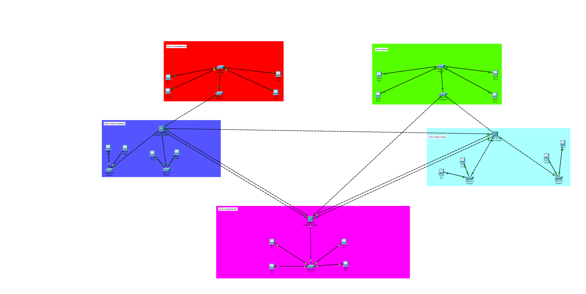

### Fase 2: Configuración de Agregación de Enlaces (EtherChannel PAgP) y Enlaces Troncales
Dado que mi carnet `202300611` finaliza en dígito impar (`1`), se implementó el protocolo propietario de Cisco **PAgP** (`mode desirable`) para agrupar enlaces físicos entre el núcleo administrativo y las dos zonas con mayor cantidad de hosts:
* **Port-channel 1 (`Po1`):** Agrupó las interfaces `Fa0/1` y `Fa0/2` entre `SW-PRIN-Z3` y `SW-PRIN-Z1` (Zona 1 - 60 hosts).
* **Port-channel 2 (`Po2`):** Agrupó las interfaces `Fa0/3` y `Fa0/4` entre `SW-PRIN-Z3` y `SW-PRIN-Z4` (Zona 4 - 50 hosts).

Posteriormente, todos los enlaces entre switches y las interfaces `Port-channel` se configuraron como enlaces troncales (`switchport mode trunk` con encapsulamiento `dot1q` en los modelos 3560), asignando la VLAN 99 como VLAN Nativa (`switchport trunk native vlan 99`) y restringiendo explícitamente el paso únicamente a las VLANs de la topología (`switchport trunk allowed vlan 11,21,31,41,51,99`).

### Fase 3: Segmentación de VLANs, Seguridad Blackhole y Dominio VTP
En los switches principales de cada zona se configuró el rol de **Servidor VTP** (`vtp mode server`) bajo el dominio `202300611` y contraseña `cayala`. Se crearon las VLANs correspondientes a cada zona (`11`, `21`, `31`, `41` y `51`), la VLAN Nativa (`99`) y la VLAN Blackhole (`999`).
* En los 7 switches de acceso secundarios se configuró el modo Cliente VTP (`vtp mode client`), logrando la sincronización automática del listado de VLANs.
* Se asignaron los puertos activos de las PCs a la VLAN de su zona respectiva con `spanning-tree portfast`, mientras que todos los puertos físicos no utilizados de los 12 switches fueron enviados a la VLAN 999 (Blackhole) en modo acceso y apagados administrativamente (`shutdown`).

### Fase 4: Configuración de Spanning Tree Protocol (Rapid PVST+)
Se activó el modo `rapid-pvst` en todos los switches de la topología para evitar bucles de Capa 2 en los anillos redundantes. Para optimizar el flujo de tramas dentro de cada zona, se asignó la prioridad explícita de `4096` (`spanning-tree vlan X priority 4096`) en el switch principal de cada zona para su VLAN local (`SW-PRIN-Z1` para VLAN 11, `SW-PRIN-Z2` para VLAN 21, `SW-PRIN-Z3` para VLAN 31 y 99, `SW-PRIN-Z4` para VLAN 41 y `SW-PRIN-Z5` para VLAN 51).

### Fase 5: Direccionamiento IP (VLSM) y Pruebas de Capa 2
Se calculó el esquema VLSM sobre la red `192.168.10.0/24` para cubrir los 60, 50, 28, 12 y 7 hosts solicitados por zona, asignando las direcciones IPv4, máscaras de subred y puertas de enlace predeterminadas a las 20 PCs. Antes de activar el enrutamiento de Capa 3, se realizaron pruebas de `ping` comprobando la conectividad total dentro de una misma VLAN (Intra-VLAN) y el aislamiento efectivo entre VLANs distintas.

### Fase 6: Enrutamiento Inter-VLAN (Capa 3) y Conectividad Extremo a Extremo
En el switch multicapa central `SW-PRIN-Z3` se habilitó el enrutamiento mediante el comando `ip routing` y se levantaron las interfaces virtuales **SVI** (`interface vlan 11, 21, 31, 41, 51 y 99`) con las direcciones IP de Default Gateway de cada subred. Finalmente, se verificó la tabla de enrutamiento con `show ip route` y se comprobó la comunicación exitosa entre todas las zonas del complejo.

---

## 2. Problemas Encontrados y Soluciones Adoptadas

Durante la configuración y puesta en marcha de la red se presentaron cuatro situaciones técnicas que fueron diagnosticadas y resueltas:

### Problema 1: Rechazo del comando `interface range` al incluir interfaces `port-channel`
* **Descripción del problema:** Al configurar los enlaces troncales en `SW-PRIN-Z3`, se intentó aplicar la configuración de `trunk` en una sola línea combinando las interfaces lógicas y físicas mediante el comando `interface range port-channel 1 - 2, gi0/1, fa0/24`. El IOS de Packet Tracer devolvió el error `% Invalid input detected at '^' marker` apuntando a `port-channel`, lo que impidió entrar al submodo de interfaz.
* **Evidencia del error en consola:**
  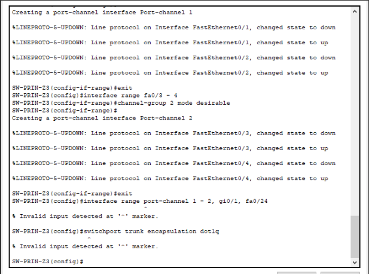
* **Solución adoptada:** Se determinó que el parser de Cisco Packet Tracer no admite interfaces virtuales `port-channel` dentro de la instrucción `interface range`. Se procedió a configurar `interface port-channel 1` e `interface port-channel 2` de manera individual, y posteriormente se utilizó `interface range fa0/1 - 4, fa0/24, gi0/1` únicamente para las interfaces físicas, logrando aplicar el encapsulamiento `dot1q`, la VLAN nativa `99` y la lista de VLANs permitidas sin errores.

### Problema 2: Mensajes de alerta `%CDP-4-NATIVE_VLAN_MISMATCH` y bloqueo temporal de PVID
* **Descripción del problema:** Tras finalizar la configuración del primer switch principal (`SW-PRIN-Z3`) con la VLAN Nativa `99`, la consola comenzó a mostrar mensajes periódicos `%CDP-4-NATIVE_VLAN_MISMATCH: Native VLAN mismatch discovered on GigabitEthernet0/1 (99), with Switch FastEthernet0/2 (1)` y alertas `%SPANTREE-2-BLOCK_PVID_LOCAL`.
* **Evidencia en consola:**
  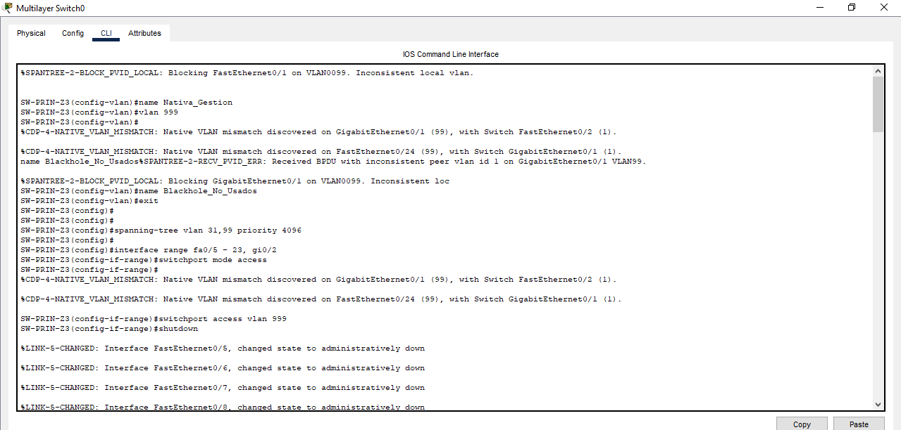
* **Solución adoptada:** Se identificó que este comportamiento era producto de que los switches vecinos aún conservaban la configuración de fábrica (VLAN nativa `1`). A medida que se aplicó el comando `switchport trunk native vlan 99` en el extremo opuesto de cada enlace troncal (tanto en los demás switches principales como en los switches clientes), la discrepancia desapareció por completo y Rapid PVST+ desbloqueó los puertos de forma automática.

### Problema 3: Diferencia de comandos de encapsulamiento entre Switches 3560 y 2960
* **Descripción del problema:** Los switches multicapa Cisco 3560 rechazan el comando `switchport mode trunk` si no se define previamente el tipo de encapsulamiento (debido a que soportan tanto ISL como IEEE 802.1Q), mientras que los switches Cisco 2960 no reconocen el comando `switchport trunk encapsulation dot1q`.
* **Solución adoptada:** En los 3 switches modelo **3560** (`SW-PRIN-Z1`, `SW-PRIN-Z3` y `SW-PRIN-Z4`) se incluyó explícitamente la instrucción `switchport trunk encapsulation dot1q` antes de activar el modo troncal; en los 9 switches modelo 2960 (que operan exclusivamente con `dot1q` por defecto) se ejecutó directamente `switchport mode trunk`.

### Problema 4: Pérdida del primer paquete ICMP (`Request timed out`) al probar conectividad Inter-VLAN
* **Descripción del problema:** Al realizar el primer `ping` desde `PC9` (Zona 1) hacia los hosts de las demás zonas (`192.168.10.162`, `192.168.10.66`, `192.168.10.130` y `192.168.10.178`) tras habilitar `ip routing`, el primer paquete de los 4 enviados expiró (`Lost = 1 (25% loss)`), mientras que los 3 restantes respondieron con éxito.
* **Solución adoptada:** Se verificó que este comportamiento es normal y esperado en redes IP debido al proceso de resolución de direcciones ARP (Address Resolution Protocol): el switch multicapa `SW-PRIN-Z3` debe emitir primero un broadcast ARP en la VLAN de destino para aprender la dirección MAC del host receptor antes de reenviar el paquete ICMP. Al ejecutar el comando `ping` por segunda vez consecutiva (con las tablas ARP ya pobladas en memoria caché), se obtuvo un 0% de pérdida (`Sent = 4, Received = 4`) en todos los destinos.

---

## 3. Evidencias de Correcto Funcionamiento

### 3.1. Verificación de Agrupación de Enlaces EtherChannel (PAgP)
Ejecución del comando `show etherchannel summary` en `SW-PRIN-Z3`, confirmando que los canales lógicos `Po1(SU)` y `Po2(SU)` se encuentran activos en Capa 2 (`S`), en uso (`U`) y negociados bajo el protocolo PAgP agrupando los puertos `Fa0/1-2` y `Fa0/3-4` (`P`):

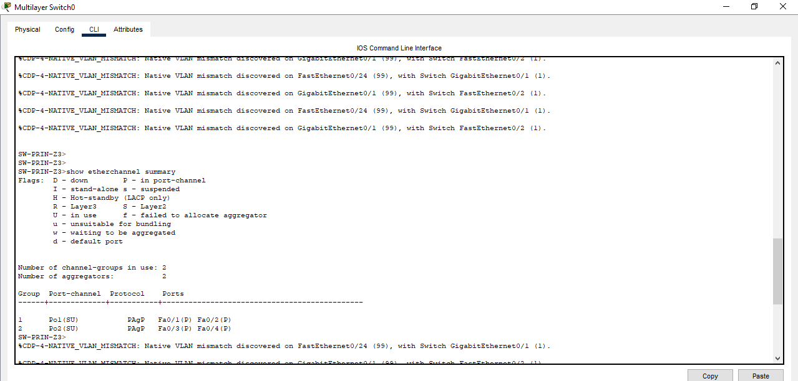

### 3.2. Verificación de VLANs y Seguridad Blackhole (VLAN 999) en Switch Principal
Ejecución de `show vlan brief` en `SW-PRIN-Z5` (`Switch1`), evidenciando la creación de las VLANs `11`, `21`, `31`, `41`, `51`, `99` y el aislamiento de todos los puertos inactivos (`Fa0/1` al `Fa0/24`) dentro de la VLAN `999 (Blackhole_No_Usados)`:

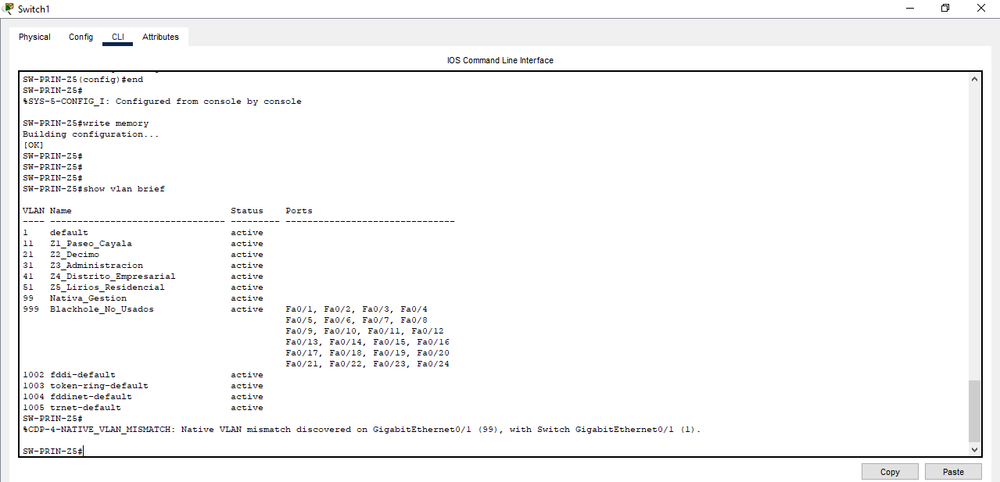

### 3.3. Verificación de Sincronización VTP y Puertos de Acceso en Switch Cliente
Ejecución de `show vtp status` y `show vlan brief` en el switch de acceso `SW-CLI-Z3` (`Switch8`), comprobando que opera en modo **`Client`** dentro del dominio **`202300611`**, habiendo aprendido las VLANs por medio del enlace troncal y asignando los puertos `Fa0/1` a `Fa0/4` a la `VLAN 31` y el resto a `Blackhole 999`:

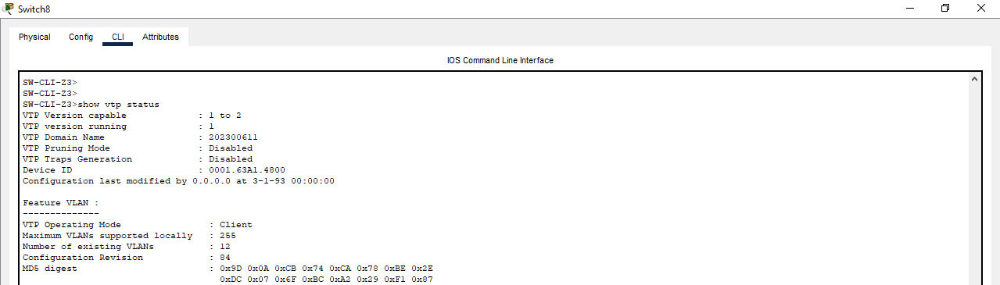
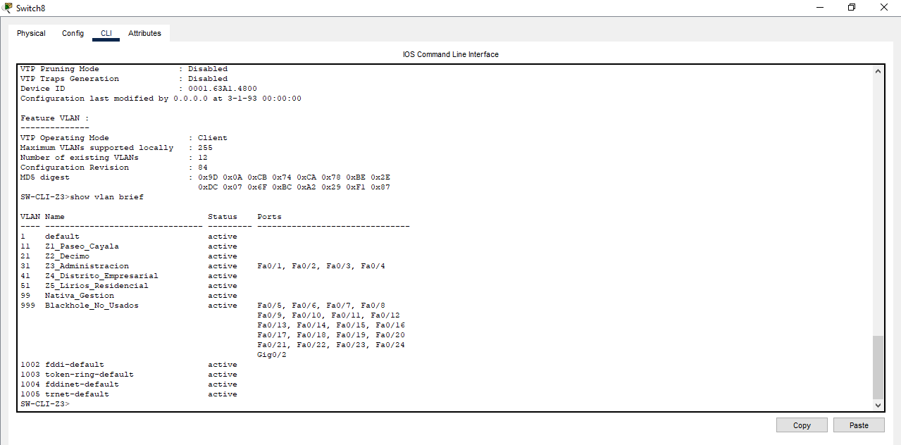

### 3.4. Pruebas de Conectividad Intra-VLAN y Aislamiento entre VLANs (Capa 2)
Pruebas realizadas desde `PC9` (`192.168.10.2` - Zona 1, conectada en `SW-CLI1-Z1`) antes de habilitar el enrutamiento de Capa 3:
1. **Conectividad Intra-VLAN exitosa (0% loss):** Respuesta inmediata desde `PC10` (`192.168.10.3`), `PC11` (`192.168.10.4`) y `PC12` (`192.168.10.5`, ubicadas en el segundo switch de acceso `SW-CLI2-Z1`), sumando 12 paquetes ICMP exitosos dentro de la misma zona con `TTL=128`.
2. **Aislamiento Inter-VLAN verificado (100% loss):** El ping hacia `192.168.10.162` (Zona 3 - VLAN 31) resulta en `Request timed out`, confirmando que los dominios de broadcast están aislados en Capa 2.

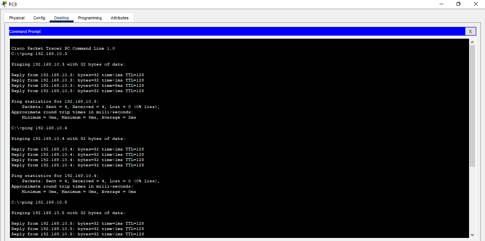
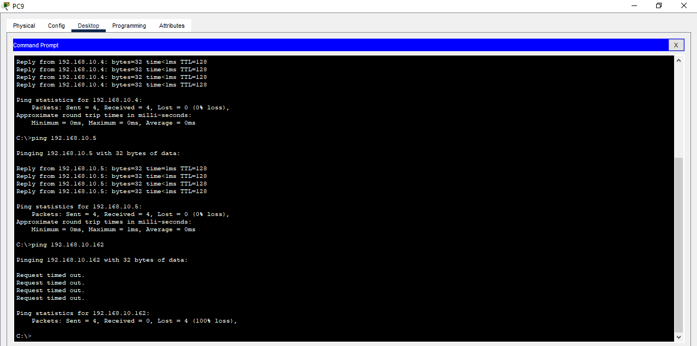

### 3.5. Verificación de Tabla de Enrutamiento (`show ip route`)
Salida del comando `show ip route` en el switch multicapa central `SW-PRIN-Z3` tras activar `ip routing` y las interfaces SVI, mostrando las 6 subredes de longitud variable (`/26`, `/27` y `/28`) directamente conectadas (`C`):

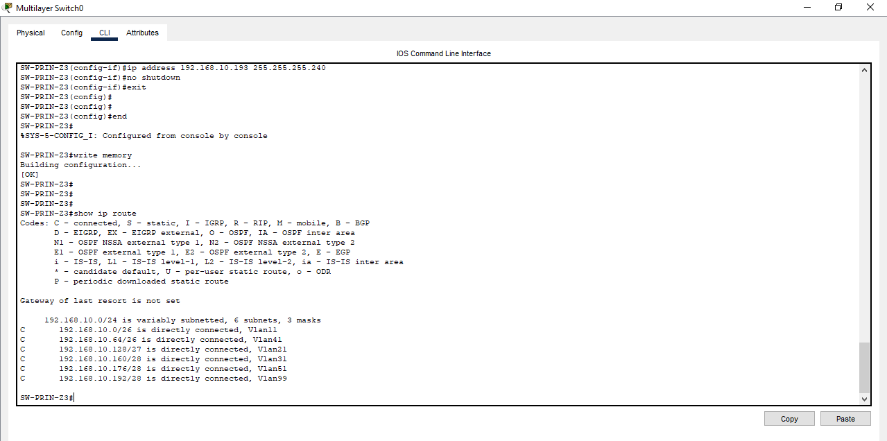

### 3.6. Pruebas de Conectividad Extremo a Extremo entre Todas las Zonas (Inter-VLAN)
Pruebas de `ping` desde `PC9` (Zona 1 - Paseo Cayalá, `VLAN 11`) hacia hosts representativos de todas las demás zonas del complejo Cayalá (`TTL=127` evidenciando el salto de enrutamiento en Capa 3 a través de `SW-PRIN-Z3`):
* Hacia **Zona 3 (Administración - `VLAN 31`):** `ping 192.168.10.162` $\rightarrow$ **0% loss (4/4 recibidos)**.
* Hacia **Zona 4 (Distrito Empresarial - `VLAN 41`):** `ping 192.168.10.66` $\rightarrow$ **0% loss (4/4 recibidos)**.
* Hacia **Zona 2 (Décimo de Cayalá - `VLAN 21`):** `ping 192.168.10.130` $\rightarrow$ **0% loss (4/4 recibidos)**.
* Hacia **Zona 5 (Lirios Residencial - `VLAN 51`):** `ping 192.168.10.178` $\rightarrow$ **0% loss (4/4 recibidos)**.

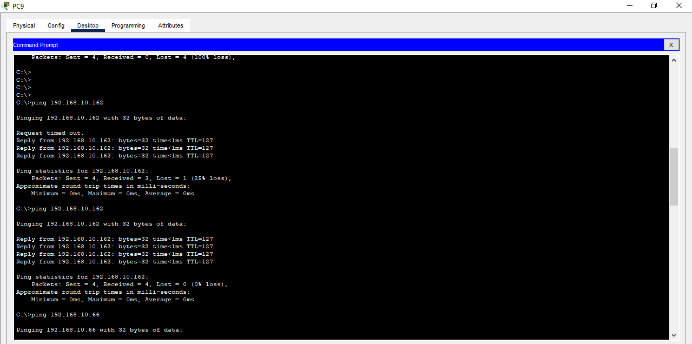
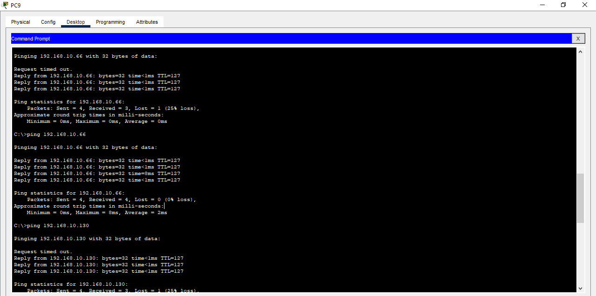
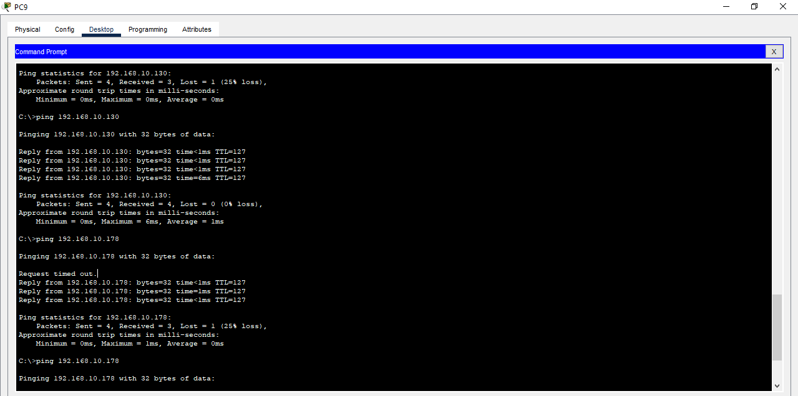
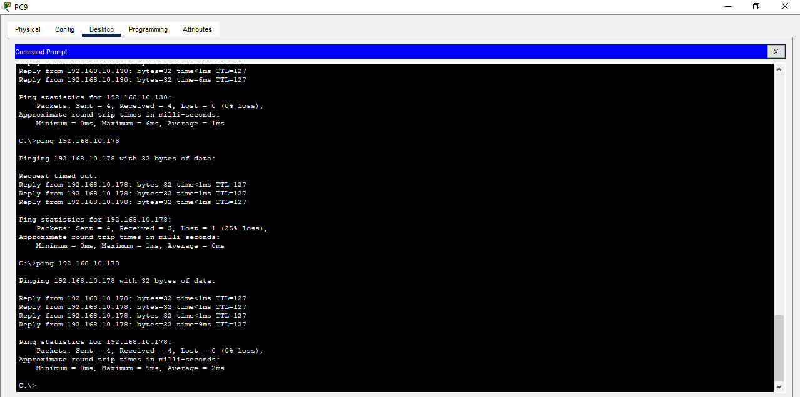