# Manual Técnico - SmartCity Tech Park
**Proyecto 1 - Redes de Computadoras 1**
**Estudiante:** David Arturo Chanquin Velasquez - 202300611

## 1. Capturas de topología completa y cada área:

### Topología General
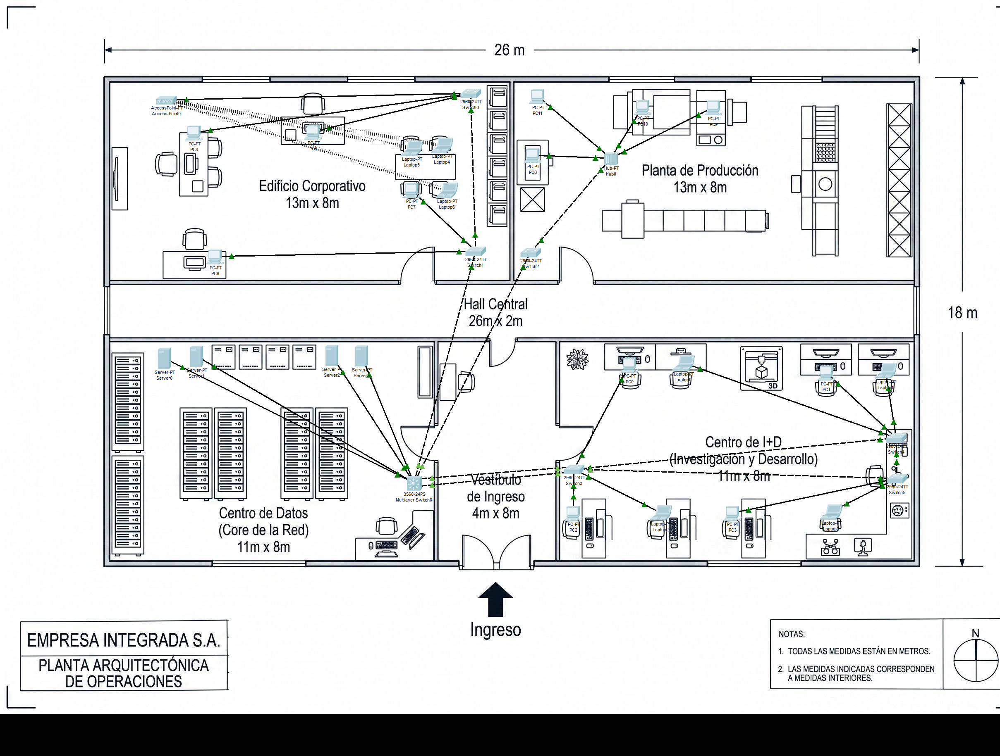

### 1.1 Centro de Datos (Core)
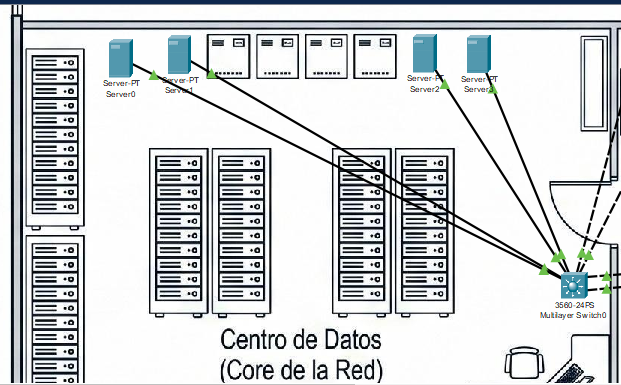

### 1.2 Centro de Investigación y Desarrollo (I+D)
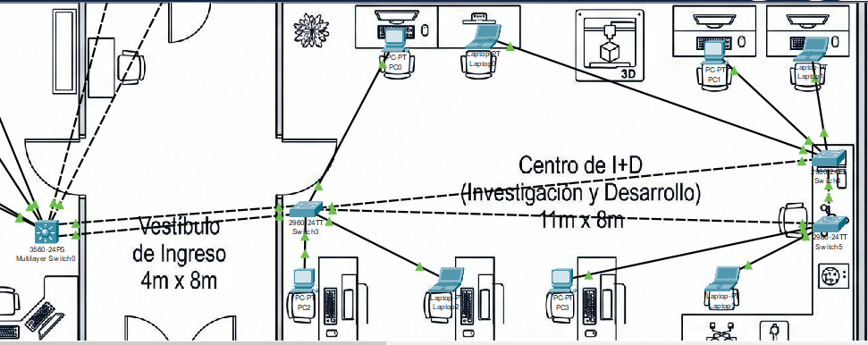

### 1.3 Edificio Corporativo
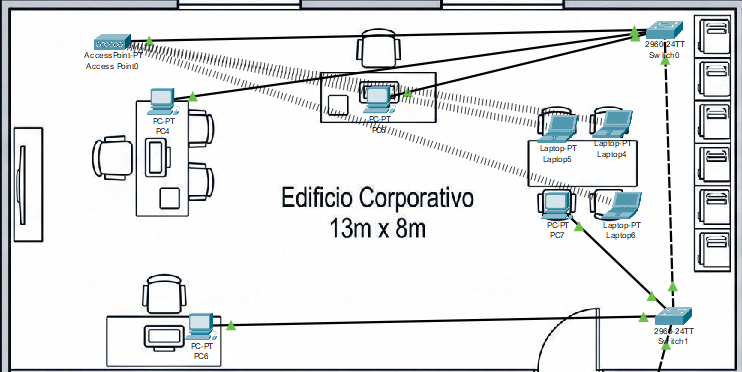

### 1.4 Planta de Producción (Segmento Legacy)
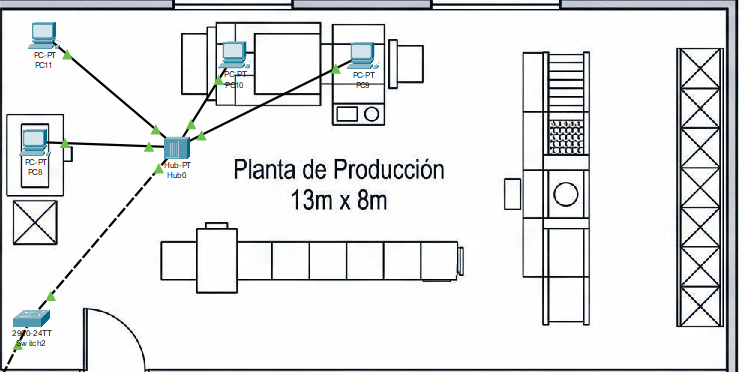

## 2. Análisis de Dominios de Colisión

En la siguiente tabla se muestra los dominios de colisión generados por cada dispositivo de red de acuerdo con sus puertos activos:

| Dispositivo de Red | Ubicación Física | Puertos Activos | Dominios de Colisión Generados |
| :--- | :--- | :---: | :---: |
| Multilayer Switch0 | Centro de Datos (Core) | 8 | 8 |
| Switch1 | Edificio Corporativo | 4 | 4 |
| Switch0 | Edificio Corporativo | 4 | 4 |
| Switch3 | Centro de I+D | 7 | 7 |
| Switch4 | Centro de I+D | 5 | 5 |
| Switch5 | Centro de I+D | 4 | 4 |
| Switch2 | Planta de Producción | 2 | 2 |
| **Hub0 (Legacy)** | **Planta de Producción** | **5** | **1 (Compartido en Capa 1)** |

**Análisis del Segmento Legacy:**
En la Planta de Producción, la maquinaria industrial (Legacy) se encuentra conectada a un Hub. Debido a la naturaleza de este dispositivo (Capa 1), las 4 computadoras y el enlace hacia el Switch2 comparten un único dominio de colisión. Esto significa que si dos equipos intentan transmitir al mismo tiempo, los datos chocarán. Sin embargo, el Switch2 actúa como una barrera de contención en su puerto de acceso, evitando que estas colisiones afecten el rendimiento del resto de la red corporativa.

## 3. Análisis de Dominios de Broadcast

En la siguiente tabla se detallan los dominios de broadcast de la red. Por principio de diseño en Capa 2, cada VLAN activa representa un dominio de broadcast aislado e independiente, conteniendo el tráfico de difusión de sus respectivos equipos.

| VLAN ID | Nombre de la VLAN | Ubicación / Propósito | Dominios de Broadcast |
| :---: | :--- | :--- | :---: |
| 11 | Gerencia | Edificio Corporativo | 1 |
| 21 | Investigacion | Centro de I+D | 1 |
| 31 | Produccion | Planta de Producción | 1 |
| 41 | Servidores | Centro de Datos (Core) | 1 |
| 51 | Visitantes | Edificio Corporativo (Inalámbrico) | 1 |
| 91 | Nativa | Backbone (Enlaces Troncales) | 1 |
| **Total** | | | **6 Dominios** |

**Análisis de Aislamiento:**
La implementación de estas VLANs garantiza que un paquete de difusión (broadcast) originado en una estación de la Planta de Producción (VLAN 31) sea contenido exclusivamente dentro de su área. El tráfico no atravesará los enlaces troncales hacia el resto de los edificios a menos que sea enrutado en Capa 3, cumpliendo con el objetivo de aislamiento inter-VLAN requerido por el complejo tecnológico.

## 4. Lista de Comandos de Configuración

A continuación, se detallan los comandos utilizados para configurar la infraestructura de red, agrupados por el rol y ubicación de los dispositivos. Todos los comandos se ejecutaron desde el modo de configuración global (configure terminal).

### 4.1 Centro de Datos (Switch Multicapa - Core)
Este dispositivo actúa como el núcleo de la red, administrando el dominio VTP, el enrutamiento de Spanning Tree y la agregación de enlaces.

```text
! 1. Configuración de Seguridad Básica
banner motd # Acceso Restringido - TechPark_202300611 #

! 2. Configuración VTP (Modo Servidor)
vtp domain Smart_1
vtp password proyecto12S2026
vtp mode server

! 3. Creación de VLANs
vlan 11
 name Gerencia
vlan 21
 name Investigacion
vlan 31
 name Produccion
vlan 41
 name Servidores
vlan 51
 name Visitantes
vlan 91
 name Nativa

! 4. Prevención de Bucles (Rapid-PVST y Root Bridge)
spanning-tree mode rapid-pvst
spanning-tree vlan 11,21,31,41,51,91 root primary

! 5. Agregación de Enlaces (PAgP hacia I+D)
interface range fastEthernet 0/23 - 24
 channel-group 1 mode desirable
 no shutdown

! 6. Configuración de Enlaces Troncales y VLAN Nativa
interface port-channel 1
 switchport trunk encapsulation dot1q
 switchport mode trunk
 switchport trunk native vlan 91

interface range gigabitEthernet 0/1 - 2
 switchport trunk encapsulation dot1q
 switchport mode trunk
 switchport trunk native vlan 91

! 7. Puertos de Acceso (Servidores)
interface range fastEthernet 0/1 - 4
 switchport mode access
 switchport access vlan 41

```
### 4.2 Centro de I+D (Switches 3, 4 y 5)
Estos equipos operan como clientes VTP y distribuyen la VLAN de investigación mediante enlaces redundantes.

```text
! 1. Seguridad y VTP Cliente
banner motd # Acceso Restringido - TechPark_202300611 #
vtp domain Smart_1
vtp password proyecto12S2026
vtp mode client

! 2. Prevención de Bucles
spanning-tree mode rapid-pvst

! 3. Agregación de Enlaces PAgP (Solo en Switch3 hacia el Core)
interface range fastEthernet 0/23 - 24
 channel-group 1 mode auto

! 4. Enlaces Troncales (Hacia el Core y entre switches de I+D)
interface port-channel 1
 switchport mode trunk
 switchport trunk native vlan 91

interface range fastEthernet 0/1 - 2  ! (Puertos internos entre switches)
 switchport mode trunk
 switchport trunk native vlan 91

! 5. Puertos de Acceso (Laptops/PCs)
interface range fastEthernet 0/3 - 6  ! (Ajustar según puertos usados)
 switchport mode access
 switchport access vlan 21

```
### 4.3 Edificio Corporativo (Switches 0 y 1)

Equipos clientes que manejan el tráfico administrativo y el inalámbrico de invitados de forma aislada.

```text
! 1. Seguridad, VTP Cliente y STP
banner motd # Acceso Restringido - TechPark_202300611 #
vtp domain Smart_1
vtp password proyecto12S2026
vtp mode client
spanning-tree mode rapid-pvst

! 2. Enlaces Troncales (Hacia el Core y cascada interna)
interface range gigabitEthernet 0/1 - 2
 switchport mode trunk
 switchport trunk native vlan 91

! 3. Puertos de Acceso (Gerencia y Visitantes)
interface fastEthernet 0/1  ! (Hacia PCs administrativas)
 switchport mode access
 switchport access vlan 11

interface fastEthernet 0/5  ! (Hacia el Access Point)
 switchport mode access
 switchport access vlan 51

```

### 4.4 Planta de Producción (Switch 2)

Switch cliente que contiene el dominio de colisión heredado del equipo industrial.

```text

! 1. Seguridad, VTP Cliente y STP
banner motd # Acceso Restringido - TechPark_202300611 #
vtp domain Smart_1
vtp password proyecto12S2026
vtp mode client
spanning-tree mode rapid-pvst

! 2. Enlaces Troncales (Hacia el Core)
interface gigabitEthernet 0/1
 switchport mode trunk
 switchport trunk native vlan 91

! 3. Puerto de Acceso (Contención del Hub Legacy)
interface fastEthernet 0/1  ! (Puerto conectado al Hub)
 switchport mode access
 switchport access vlan 31

```

## 5. Tabla de VLANs

De acuerdo con lo que pedia el pdf del proyecto, el ID de cada VLAN se calculó utilizando el último dígito de mi carnet (202300611), siendo este el número 1.

| VLAN ID | Nombre de la VLAN | Descripción / Uso |
| :---: | :--- | :--- |
| **11** | Gerencia | Segmento para el personal administrativo del Edificio Corporativo. |
| **21** | Investigacion | Segmento de alta disponibilidad para las estaciones de trabajo del Centro de I+D. |
| **31** | Produccion | Segmento industrial para la contención del dominio de colisión heredado (Legacy). |
| **41** | Servidores | Segmento aislado para los servidores críticos alojados en el Centro de Datos. |
| **51** | Visitantes | Segmento exclusivo para invitados vía conexión inalámbrica (Access Point). |
| **91** | Nativa | VLAN asignada para el tráfico sin etiquetar y protocolos de control en los enlaces troncales. |

## 6. Tabla de Asignación de Puertos por Switch

A continuación, se detalla la asignación de puertos físicos a sus respectivas VLANs o enlaces troncales en cada dispositivo de la topología.

| Ubicación / Switch | Interfaz (Puerto) | Modo de Operación | VLAN Asignada / Función |
| :--- | :--- | :--- | :--- |
| **Centro de Datos (Core)** | `Fa0/23 - Fa0/24` | Trunk (LACP/PAgP) | Troncal (Nativa 91) - Hacia I+D |
| Multilayer Switch0 | `Fa0/2` | Trunk | Troncal (Nativa 91) - Hacia Producción |
| | `Fa0/1` | Trunk | Troncal (Nativa 91) - Hacia Corporativo |
| | `Fa0/1, 3, 5, 7` | Access | VLAN 41 (Servidores) |
| **Centro de I+D** | `Fa0/23 - Fa0/24` | Trunk (LACP/PAgP) | Troncal (Nativa 91) - Hacia Core |
| Switch 3 | `Fa0/2 - Fa0/2` | Trunk | Troncal (Nativa 91) - Hacia Switch 4 |
| | `Fa0/8, 9, 10` | Access | VLAN 21 (Investigacion) |
| Switch 4 | `Fa0/2 - Fa0/3` | Trunk | Troncal (Nativa 91) - Enlaces internos |
| | `Fa0/6, 7, 8` | Access | VLAN 21 (Investigacion) |
| Switch 5 | `Fa0/3 - Fa0/4` | Trunk | Troncal (Nativa 91) - Enlaces internos |
| | `Fa0/1, 5` | Access | VLAN 21 (Investigacion) |
| **Edificio Corporativo** | `Fa0/1 - Fa0/1` | Trunk | Troncal (Nativa 91) - Hacia Core / Internos |
| Switch 1 | `Fa0/4, 5, 7` | Access | VLAN 11 (Gerencia) |
| | `Fa0/24` | Access | VLAN 51 (Visitantes - Access Point) |
| Switch 0 | `Fa0/5 - Fa0/5` | Trunk | Troncal (Nativa 91) - Enlaces internos |
| | `Fa0/1, 3` | Access | VLAN 11 (Gerencia) |
| **Planta de Producción** | `Fa0/2` | Trunk | Troncal (Nativa 91) - Hacia Core |
| Switch 2 | `Fa0/3` | Access | VLAN 31 (Produccion - Hacia Hub) |

## 7. Justificaciones de Diseño y Protocolos

### 7.1 VTP (VLAN Trunking Protocol) - Switch Servidor

**Captura de validación (show vtp status):**
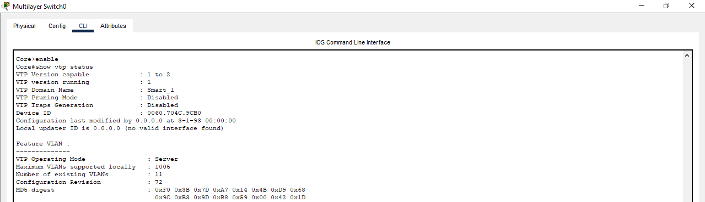

**Justificación Técnica:**
Para la administración centralizada de las VLANs, se configuró el dominio `Smart_1` y la contraseña requerida `proyecto12S2026`. Se designó al Multilayer Switch0 **(Centro de Datos)** como el único equipo en modo VTP Server. Esta decisión obedece a las mejores prácticas del modelo de diseño jerárquico: al centralizar la administración lógica en el Core de la red, se garantiza que cualquier modificación en la base de datos de VLANs se propague de forma descendente y unidireccional hacia los switches de distribución y acceso de los demás edificios (configurados en modo VTP Client). Esto centraliza la seguridad, previene inconsistencias por configuraciones accidentales en equipos de borde y reduce la sobrecarga administrativa del campus.

### 7.2 Spanning Tree Protocol (STP) - Root Bridge

**Captura de validación (show spanning-tree):**
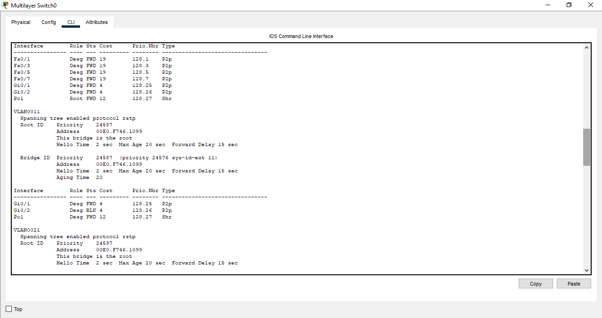

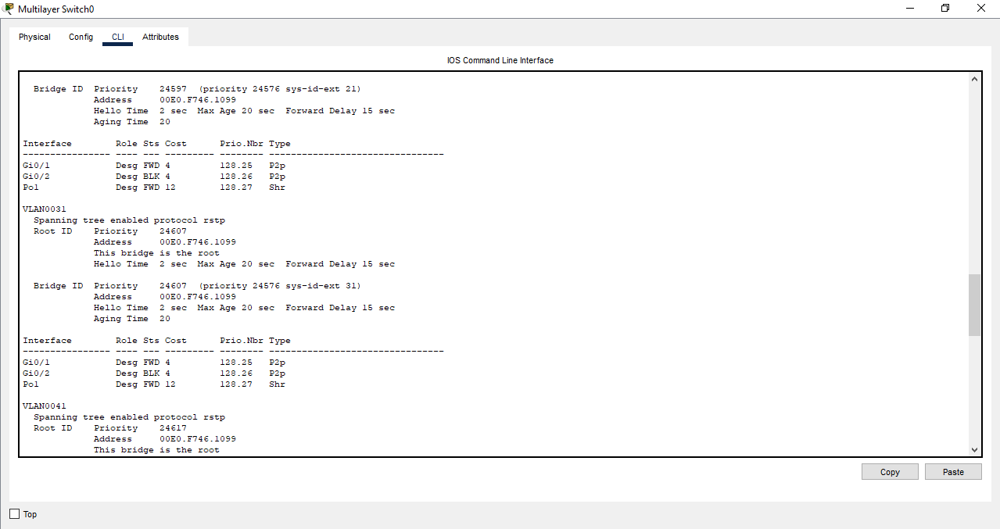

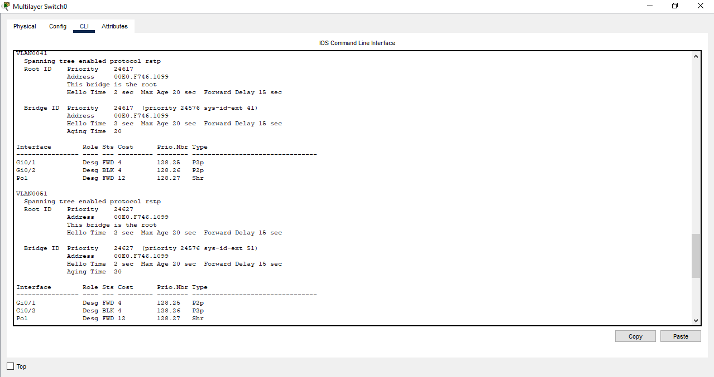

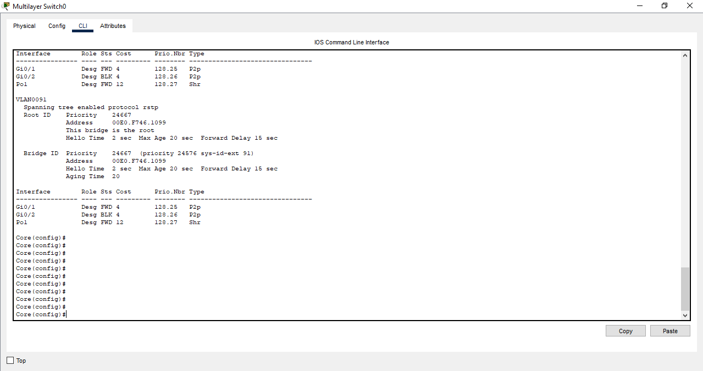

**Justificación Técnica:**
Conforme a lo que dice el proyecto, al finalizar el número de carné en dígito impar (202300611), se implementó el protocolo **Rapid-PVST** en todos los equipos de conmutación para garantizar tiempos de convergencia rápidos. 

Se seleccionó y forzó al Multilayer Switch0 (Centro de Datos) para que actúe como el **Root Bridge** (puente raíz) primario de todas las VLANs activas de la topología. Esta decisión se fundamenta en el diseño jerárquico de la red: el Core es el equipo con mayor capacidad de procesamiento y el centro físico donde convergen los enlaces de todos los edificios y los servidores crítico. Al ponerlo como la raíz del árbol de expansión, se garantiza que el tráfico siempre tome la ruta más corta y eficiente hacia el centro de la red. Si se hubiera dejado la elección por defecto, un switch de acceso de menor capacidad (como el de la Planta de Producción) podría haber asumido este rol, causando bloqueos de puertos  y cuellos de botella graves en la comunicación entre las áreas.

### 7.3 Agregación de Enlaces (EtherChannel)

**Captura de validación (show etherchannel summary):**
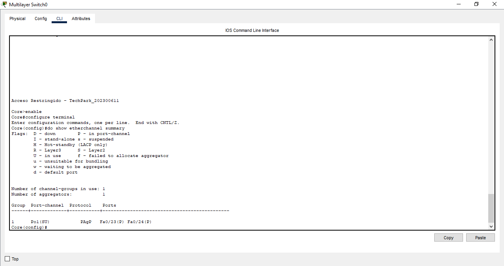

**Justificación Técnica:**
De acuerdo con las reglas del proyecto, se implementó la agregación de enlaces utilizando el protocolo de Cisco **PAgP**, condición obligatoria dado que el último dígito de mi carné (202300611) es impar.

Este canal (Port-channel 1) se implementó estratégicamente en la conexión troncal entre el **Centro de Datos (Core)** y el Centro de Investigación y Desarrollo (I+D). La decisión responde directamente a la necesidad del enunciado, el cual establece que el I+D debe soportar una mayor demanda de ancho de banda y garantizar alta disponibilidad ante fallas. Al agrupar múltiples interfaces físicas en una sola interfaz lógica, logramos sumar la capacidad de transmisión (duplicando el ancho de banda) y proveemos redundancia inmediata en Capa 2: si un cable físico sufre un corte, el tráfico de I+D conmutará automáticamente al enlace restante sin experimentar caídas de servicio.